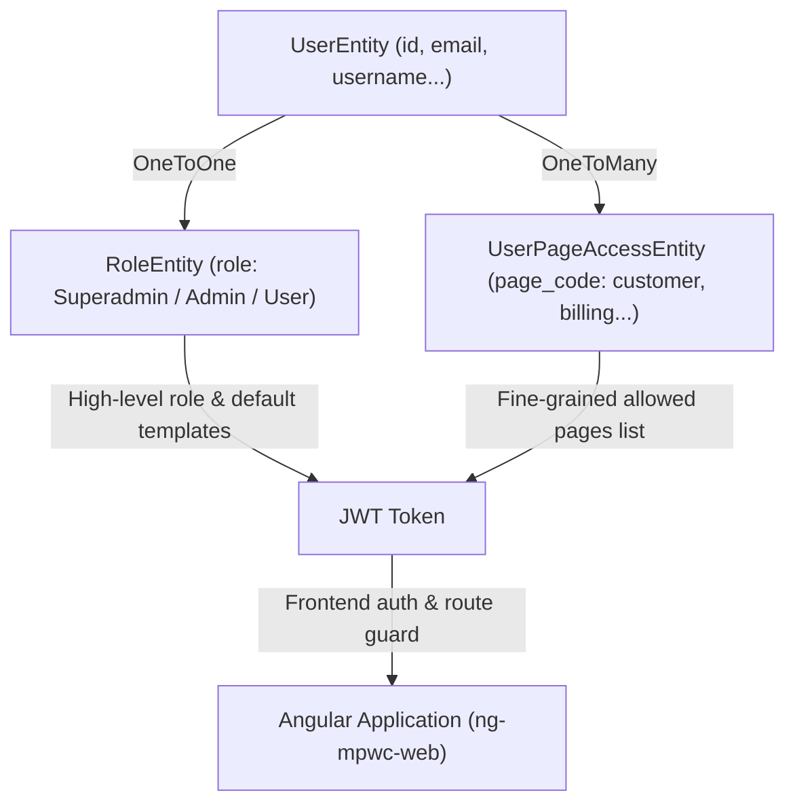

# Role & Customizable Page-Level Authorization Implementation Plan

## 1. Executive Summary

This document specifies the technical design and phased implementation plan for adding customizable, user-specific page-level authorization to the **Mahabang Parang Waterworks Cooperative (MPWC)** platform. 

The solution introduces a dedicated `UserPageAccessEntity` in the Spring Boot backend (`api-user`), bundles assigned page access into the JWT token, dynamically filters the Angular frontend sidebar navigation, and enforces route guards that trigger warning popups (via SweetAlert2) when unauthorized access is attempted.

---

## 2. Architectural Design & Coexistence with `RoleEntity`

### What happens to the existing `UserEntity` ↔ `RoleEntity` implementation?

> [!NOTE]
> **No breaking changes to `RoleEntity`.**
> `RoleEntity` and `user.role` remain the foundational high-level classification in the backend, while `UserPageAccessEntity` adds fine-grained page authorization.



1. **Role as Persona & Default Template**:
   - **`Superadmin`**: The technical administrator. Has universal access to all pages by default (`*` / full catalog), without requiring explicit page toggles.
   - **`Admin`**: On user creation, default is assigned **all pages**. An admin/superadmin can later customize, restrict, or re-grant individual page permissions for this user.
   - **Other Roles / Standard Users**: Receive custom page access assigned during or after account creation.
2. **Spring Security Authorities**:
   - `UserEntity.getAuthorities()` retains `role.getRole()` for backend Spring Security role validation.
3. **JWT Synergy**:
   - The JWT token payload will carry both:
     - `role`: The high-level role name (e.g., `Superadmin`, `Admin`).
     - `pageAccess`: The list of permitted page keys (e.g., `["dashboard", "customer", "billing", "reports"]`).

---

## 3. Page Catalog & Permissions Key Mapping

The system defines discrete page keys mapping 1-to-1 with Angular route modules:

| Page Code | Label / Module | Frontend Route | Sidebar Nav | Default for Admin/Superadmin |
| :--- | :--- | :--- | :--- | :--- |
| `dashboard` | Dashboard / Home | `/dashboard` | `Dashboard` | Yes |
| `customer` | Customer Management | `/customer/**` | `Customer` | Yes |
| `billing` | Billing Management | `/billing/**` | `Billing` | Yes |
| `payment_or` | Official Receipt Payment | `/payment/official-receipt/**` | `OR Payment` | Yes |
| `payment_other`| Other Payment | `/payment/other-receipt/**` | `Other Payment` | Yes |
| `reports` | Reports & Collections | `/reports/**` | `Reports` | Yes |
| `settings` | Settings (Rates/Parts) | `/settings/**` | `Settings` | Yes |
| `admin_users` | Administration (Users) | `/admin/users/**` | `Administration` | Yes |

---

## 4. Backend Implementation (`api-user`)

### A. New Entity: `UserPageAccessEntity`
- **Location**: `com.mahabang_parang.api_user.model.entity.UserPageAccessEntity`
- **Table**: `user_page_access`
- **Schema**:
  ```java
  package com.mahabang_parang.api_user.model.entity;

  import com.fasterxml.jackson.annotation.JsonIgnore;
  import jakarta.persistence.*;
  import lombok.*;

  @Entity
  @Table(name = "user_page_access", 
         uniqueConstraints = @UniqueConstraint(columnNames = {"user_id", "page_code"}))
  @Getter
  @Setter
  @NoArgsConstructor
  @AllArgsConstructor
  @Builder
  public class UserPageAccessEntity {

       @Id
       @GeneratedValue(strategy = GenerationType.UUID)
       @Column(length = 36, nullable = false)
       private String id;

       @ManyToOne(fetch = FetchType.LAZY)
       @JoinColumn(name = "user_id", nullable = false)
       @JsonIgnore
       private UserEntity user;

       @Column(name = "page_code", nullable = false, length = 50)
       private String pageCode;
  }
  ```

### B. Update `UserEntity`
- Add relationship to [UserEntity](file:///c:/Users/Rcrafael/Documents/mparang-backend/api-user/src/main/java/com/mahabang_parang/api_user/model/entity/UserEntity.java):
  ```java
  @OneToMany(mappedBy = "user", cascade = CascadeType.ALL, orphanRemoval = true, fetch = FetchType.EAGER)
  private List<UserPageAccessEntity> pageAccess = new ArrayList<>();
  ```

### C. Repository: `UserPageAccessRepository`
- Add repository for queries:
  ```java
  public interface UserPageAccessRepository extends JpaRepository<UserPageAccessEntity, String> {
      List<UserPageAccessEntity> findByUserId(String userId);
      void deleteByUserId(String userId);
  }
  ```

### D. DTO and Payload Updates
1. **`UserDto`**: Add `private List<String> pageAccess;`
2. **`RegisterPayload`**: Add `private List<String> pageAccess;`
3. **`UpdateUserPayload`**: Add `private List<String> pageAccess;`
4. **`UserMapper`**: Update custom mapping methods to convert between `List<UserPageAccessEntity>` and `List<String>`.

### E. Service Layer Updates (`UserServiceImpl`)
1. **`register(RegisterPayload payload)`**:
   - Determine role (`Superadmin`, `Admin`, or others).
   - If role is `Superadmin` or `Admin` and `payload.getPageAccess()` is empty, populate all available page codes by default.
   - If `payload.getPageAccess()` is provided, map each string code to `UserPageAccessEntity` and attach to `user`.
2. **`updateUser(UpdateUserPayload payload)`**:
   - If `payload.getPageAccess()` is provided:
     - Clear existing `user.getPageAccess()`.
     - Add new `UserPageAccessEntity` instances for each code in `payload.getPageAccess()`.
     - Save updated user entity.

### F. JWT Token Update (`JwtUtil`)
- In [JwtUtil.java](file:///c:/Users/Rcrafael/Documents/mparang-backend/api-user/src/main/java/com/mahabang_parang/api_user/security/JwtUtil.java):
  - Check if role is `Superadmin`: grant all catalog pages.
  - Otherwise, extract `userDetails.getPageAccess().stream().map(UserPageAccessEntity::getPageCode).toList()`.
  - Add claim to JWT:
    ```java
    .claim("role", userDetails.getRole() != null ? userDetails.getRole().getRole() : "")
    .claim("pageAccess", effectivePages)
    ```

### G. Available Pages Metadata Endpoint
- Add `GET /api/user/pages`: Returns the catalog of all system page codes and display labels so the frontend UI stays synchronized with backend definitions.

---

## 5. Frontend Implementation (`ng-mpwc-web`)

### A. Page Permissions Model & Catalog (`src/app/common/enum.ts`)
- Define page keys and catalog:
  ```typescript
  export interface IPageDefinition {
    code: string;
    label: string;
    description: string;
  }

  export const ALL_PAGE_DEFINITIONS: IPageDefinition[] = [
    { code: 'dashboard', label: 'Dashboard', description: 'Overview and analytical charts' },
    { code: 'customer', label: 'Customers', description: 'Customer profiles and meter assignments' },
    { code: 'billing', label: 'Billing', description: 'Meter readings and bill creation' },
    { code: 'payment_or', label: 'Official Receipt', description: 'OR payment processing' },
    { code: 'payment_other', label: 'Other Payments', description: 'Non-OR collections and miscellaneous payments' },
    { code: 'reports', label: 'Reports', description: 'Collection and billing reports' },
    { code: 'settings', label: 'Settings', description: 'Water rates, parts, and default values' },
    { code: 'admin_users', label: 'Administration', description: 'User management and permissions' },
  ];
  ```

### B. Auth Service Enhancements (`src/app/services/auth.service.ts`)
- Add helper methods to inspect permissions from the decoded JWT:
  ```typescript
  isSuperAdmin(): boolean {
    const decoded = this.decodeToken();
    const roleName = (decoded?.role?.role || decoded?.role || '').toLowerCase();
    return roleName === 'superadmin';
  }

  getUserPages(): string[] {
    if (this.isSuperAdmin()) {
      return ALL_PAGE_DEFINITIONS.map(p => p.code);
    }
    const decoded = this.decodeToken();
    return decoded?.pageAccess || [];
  }

  hasPageAccess(pageCode: string): boolean {
    if (this.isSuperAdmin()) return true;
    return this.getUserPages().includes(pageCode);
  }
  ```

### C. Page Access Guard (`src/app/guard/page-access.guard.ts`)
- Create functional guard:
  ```typescript
  export const pageAccessGuard: CanActivateFn = async (route, state) => {
    const authService = inject(AuthService);
    const alertService = inject(AlertService);
    const router = inject(Router);

    const requiredPage = route.data?.['page'] as string;
    if (!requiredPage) return true;

    if (authService.hasPageAccess(requiredPage)) {
      return true;
    }

    // Trigger SweetAlert popup
    await alertService.alert('You do not have permission to access this page. Please contact your administrator.', {
      icon: 'warning',
      confirmButtonText: 'Understood'
    });

    // Stay on current page or redirect to allowed fallback
    router.navigateByUrl('/dashboard');
    return false;
  };
  ```

### D. Route Registration (`src/app/app.routes.ts`)
- Attach `pageAccessGuard` and `data: { page: '...' }` to routes:
  - `/customer/**` → `data: { page: 'customer' }`, `canActivate: [authGuard, pageAccessGuard]`
  - `/billing/**` → `data: { page: 'billing' }`, `canActivate: [authGuard, pageAccessGuard]`
  - `/payment/official-receipt/**` → `data: { page: 'payment_or' }`
  - `/payment/other-receipt/**` → `data: { page: 'payment_other' }`
  - `/reports/**` → `data: { page: 'reports' }`
  - `/settings/**` → `data: { page: 'settings' }`
  - `/admin/users/**` → `data: { page: 'admin_users' }`

### E. Sidebar Dynamic Filtering (`sidebar.component.ts`)
- Filter `naviMenus` based on `authService.hasPageAccess(...)`:
  - When filtering top-level menus and submenus, omit items where `hasPageAccess(menu.code)` is false.
  - If a parent menu (like `Administration` or `Settings`) has no allowed sub-items, hide the parent item completely.
  - Prevents menu clutter and user confusion.

### F. User Management UI (`users-create` & `users-update`)
- In `users-update.component.html` and `users-create.component.html`:
  - Utilize the vacant right-hand side (`col-span-6 col-start-7`) of the 12-column grid.
  - Add a **"Page Permissions"** panel with accessible styled checkboxes.
  - Add quick action buttons: **"Select All"** and **"Deselect All"**.
  - When role selection is changed to `Admin`, automatically check all pages.
  - When saving, bundle `pageAccess: string[]` in the form payload sent to `api-user`.

---

## 6. Verification and Testing Checklist

- [ ] **Database & Entity Verification**: Verify table `user_page_access` is generated and linked via foreign key to `user`.
- [ ] **JWT Claim Inspection**: Login as a user and verify `pageAccess` array is present in the JWT payload.
- [ ] **Sidebar Visibility Test**:
  - Assign `['dashboard', 'customer', 'billing']` to a test user.
  - Log in: verify only `Dashboard`, `Customer`, and `Billing` are displayed in the sidebar.
- [ ] **Direct URL Access & Alert Popup Test**:
  - Attempt manual address-bar navigation to `/reports` or `/settings`.
  - Verify the navigation is intercepted, the SweetAlert2 dialog appears, and the user is redirected safely to `/dashboard`.
- [ ] **Superadmin Universal Access Test**:
  - Log in as `Superadmin`: confirm all menu items and pages are accessible.
- [ ] **Admin Customization Test**:
  - Create a new `Admin`: verify all pages are checked by default.
  - Uncheck `Reports` and save: verify the admin user no longer has access to `Reports`.
